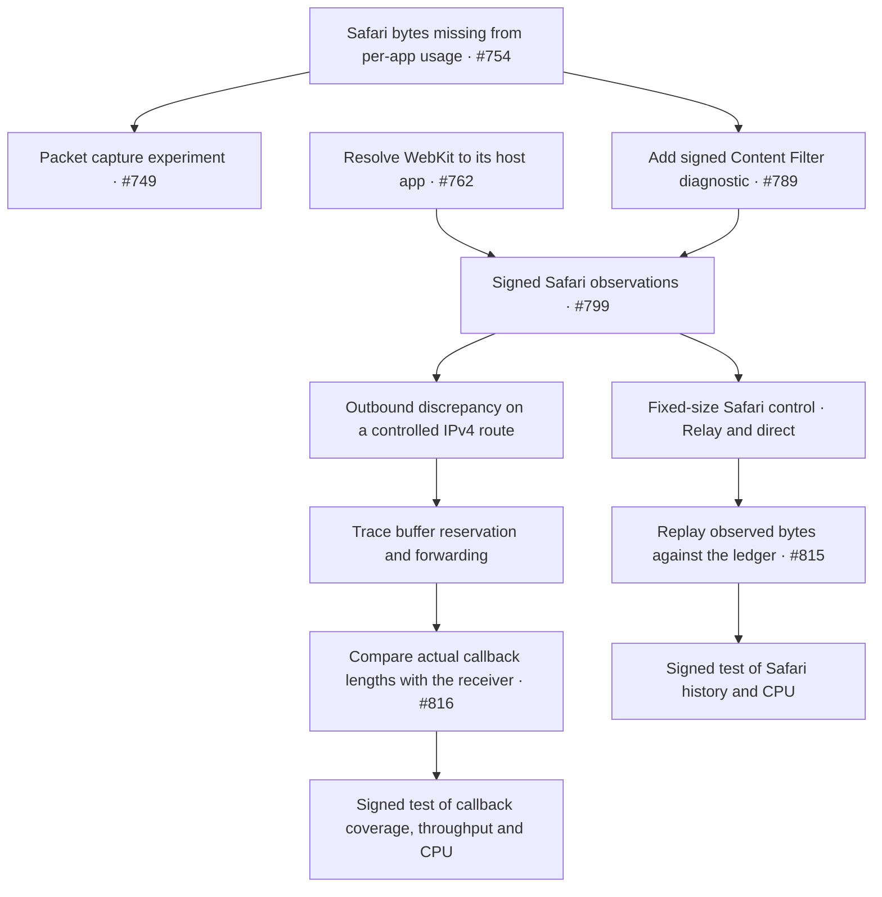

# Private Relay evidence and implementation map

Prepared for [NetworkMonitor #799](https://github.com/kevinabouhanna/NetworkMonitor/issues/799). The receive implementation is [PR #815](https://github.com/kevinabouhanna/NetworkMonitor/pull/815). The independent outbound diagnostic is [PR #816](https://github.com/kevinabouhanna/NetworkMonitor/pull/816). Both PRs include the switch and a signed-build validation procedure.



## Investigation in order

| Step | Observed result | Evidence or code |
| --- | --- | --- |
| Original report | A Safari session with Relay produced an unusually large unattributed remainder. Switching Relay off restored WebKit attribution. | [#754](https://github.com/kevinabouhanna/NetworkMonitor/issues/754) |
| Try broader process accounting | Removing the `nettop` interface filter did not recover the missing bytes in the initial logs. Those logs had limited simultaneous interface evidence, so the later fixed-size test repeated both modes. | [Original discussion](https://github.com/kevinabouhanna/NetworkMonitor/issues/754) and [fixed-size process rows](evidence/safari-fixed-size.json) |
| Explore capture and owner resolution | The packet-capture prototype remains available for reference. The maintainer chose the Content Filter route for cost and privacy. The shared WebKit resolver shipped separately. | [Packet-capture PR #749](https://github.com/kevinabouhanna/NetworkMonitor/pull/749), [WebKit PR #762](https://github.com/kevinabouhanna/NetworkMonitor/pull/762) |
| Run the signed diagnostic | Two Safari Relay runs produced approximately 20–21 MB in a single WebKit flow. The initial launch attempt was blocked by Safari's HTTPS-only mode, and an already-open Safari session showed little traffic in one run. A later warm run enrolled a new flow and recovered the bytes. Different YouTube workloads limited the CPU comparison. | [Initial measurements and controls](https://github.com/kevinabouhanna/NetworkMonitor/issues/799#issuecomment-7203512579), [six anonymized observations](evidence/safari-youtube.json), [shipped diagnostic #789](https://github.com/kevinabouhanna/NetworkMonitor/pull/789) |
| Measure the outgoing discrepancy | On a single external IPv4 route, BSD UDP and OpenSSL QUIC agreed with the receiver. Network.framework reported 2,020 B per datagram in the affected trials. A separate debugger run located the buffer reservation used in that counter. | [VPS report](https://github.com/kevinabouhanna/NetworkMonitor/issues/799#issuecomment-7207173291), [receiver and filter records](evidence/vps-runs.json), [debugger capture](evidence/outbound-debugger.txt) |
| Repeat Safari with fixed input | Four private-window runs each received 2,000,000 application bytes. Server egress matched the direct reference only in the direct arms. Both modes of the process stream missed the Relay transfer. The filter recovered 2,008,998 B after the pre-download baseline. On the direct control both measured 2,008,809 B over the transfer. | [Four-arm report](https://github.com/kevinabouhanna/NetworkMonitor/issues/799#issuecomment-7219703646), [anonymized event and counter rows](evidence/safari-fixed-size.json), [Safari workload](safari-download.js) |
| Exercise the proposed changes | The read-side SQL restores the Relay bytes and adds zero for the direct transfer in the recorded inputs. The outbound diagnostic has local tests for overlapping ranges and gaps. It needs a signed run against the receiver to verify actual Network Extension delivery and overhead. | [PR #815](https://github.com/kevinabouhanna/NetworkMonitor/pull/815), [PR #816](https://github.com/kevinabouhanna/NetworkMonitor/pull/816), [replay output](evidence/replay-results.txt) |

## Recalculate the results

From this directory run:

```sh
python3 replay-evidence.py
```

To exercise the same SQL as the proposed app change, pass [UsageHistory.swift at the PR's tested commit](https://github.com/defragekb/NetworkMonitor/blob/2ab64cd8c8654707d64b9aa2afd52036507f74cb/Sources/NetworkMonitorCore/UsageHistory.swift):

```sh
python3 replay-evidence.py --usage-history /path/to/NetworkMonitor/Sources/NetworkMonitorCore/UsageHistory.swift
```

The replay reads the DDL from that file. It uses a minimal in-memory ledger with the measured interface and WebKit inputs. It checks Relay, direct and a synthetic mixed interval made by combining both observed captures. The app's regression tests in #815 separately cover production history writes, a delayed `nettop` update, hour and network boundaries, several apps sharing one budget, and CSV remainders. The four-arm Safari test exercises the shipped diagnostic. Repeating it in a signed build of #815 will exercise XPC and the actual Usage History row.

## How the measurements map to code

- **Receive path.** The filter asks macOS for cumulative reports, derives receive deltas and resolves the flow owner using the existing WebKit lookup. XPC passes the app key and byte delta to the app. The app reconciles after a later `nettop` interval and accepts reports that fit within one hour and visit. SQLite recalculates the app's remaining gap up to the unattributed receive budget. A later `nettop` update naturally shrinks the credit. The scope is Usage History and CSV. A route with bytes already assigned to a carrier or different coverage between sources still needs explicit validation. [PR #815 files](https://github.com/kevinabouhanna/NetworkMonitor/pull/815/files)
- **Outbound diagnosis.** The numeric result follows `38 × 2,020 = 76,760`. The frame inspector saw 2,048 B allocated, 28 B headroom and zero filled bytes at reservation. [Projected debugger data](evidence/outbound-debugger.json)
- **Outbound diagnostic.** The proposed filter measures lengths from `handleOutboundData` after allow. It tracks offsets, counts each covered byte range once and marks gaps and limits. It writes diagnostic results while the existing usage path keeps working. Run the [small UDP sender and receiver](README.md#outbound-counter-on-one-ipv4-route) in a signed build with and without the outbound diagnostic, then repeat with QUIC and Relay before considering usage accounting. [PR #816 files](https://github.com/kevinabouhanna/NetworkMonitor/pull/816/files)

## Provenance and limits of the captures

- The fixed-size fixture uses the browser receipt, two interface and process CPU readings, process rows from both `nettop` streams and Content Filter open, statistics and close lines. Interface and CPU readings are rebased within each run. Times are milliseconds relative to the first download script request. The process table retains nonzero rows, aliases unrelated processes and skips the initial cumulative sample. The replay sums process rows from −180 ms through 1,250 ms after the last browser receipt. It also checks the peak process across the wider interface window.
- The filter fixture retains cumulative values and event ordering for the captured flows. It uses run-local flow IDs and a WebKit label. The replay selects the new WebKit flow opened before the transfer and subtracts the last pre-transfer report. This keeps the earlier 2 MB close belonging to another flow out of the calculation. The tested Relay flow's final close adds zero.
- The YouTube file preserves the reported counters and Safari-flow summaries. The external IPv4 file preserves the receiver measurements and per-flow reports from the same-route comparison plus the preliminary matrix and kernel-path comparison. Kernel and debugger measurements are independent runs.
- **QUIC figure clarification.** The retained six-trial VPS matrix records 8,167 B at the receiver for the 38-datagram Network.framework QUIC run. A separate debugger run forwarded 8,159 B. Both show 76,760 B in reserved capacity or the inflated report. The two figures have distinct sources.
- These are projections of the saved evidence. Process IDs, IP addresses, egress fingerprints, hostnames, local paths, absolute times, packet payloads, credentials and memory addresses were removed. [Checksums for the published files](evidence/SHA256SUMS)
